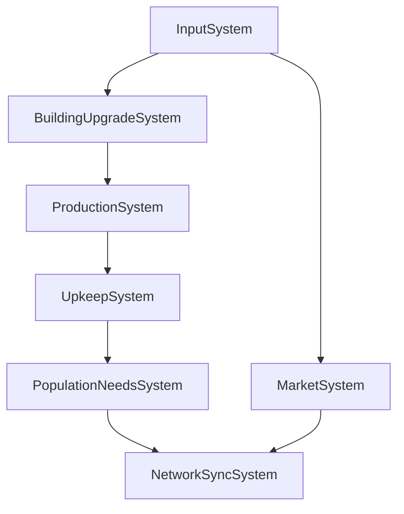

# System Dependencies Graph v0.2

## Orden de Ejecución por Tick

1. **InputSystem** → procesa comandos jugador
   Outputs: comandos de build/upgrade/trade

2. **BuildingUpgradeSystem** → actualiza progreso construcción
   Requiere: BuildingComponent, UpgradeQueueComponent
   Escribe: Building.state, Building.level, Building.progress

3. **ProductionSystem** → genera recursos
   Requiere: BuildingComponent, ProductionComponent, ResourceStorageComponent
   Lee: Building.state, Building.efficiency
   Escribe: ResourceStorage.*, Production.accumulator

4. **UpkeepSystem** → deduce mantenimiento
   Requiere: BuildingComponent, ResourceStorageComponent
   Escribe: ResourceStorage.gold, Building.state

5. **PopulationNeedsSystem** → felicidad y crecimiento
   Requiere: PopulationComponent, ResourceStorageComponent
   Escribe: Population.happiness, Population.population

6. **MarketSystem** → trades on demand
   Requiere: ResourceStorageComponent

7. **NetworkSyncSystem** → serializa delta
   Requiere todos

## Shared Components
- ResourceStorageComponent usado por Production, Upkeep, Population, Market
- BuildingComponent usado por Upgrade, Production, Upkeep

## Reglas
- No writes concurrentes al mismo componente en un tick
- ProductionSystem debe correr después de UpgradeSystem para aplicar nuevos rates
- UpkeepSystem después de Production para evitar doble gasto

## Gráfico Mermaid

