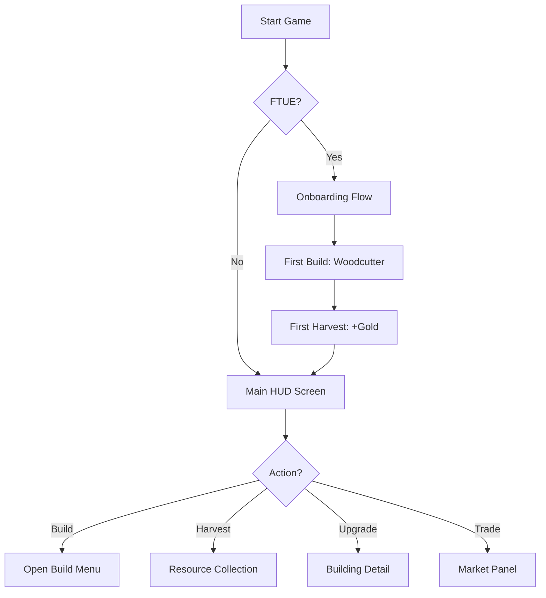
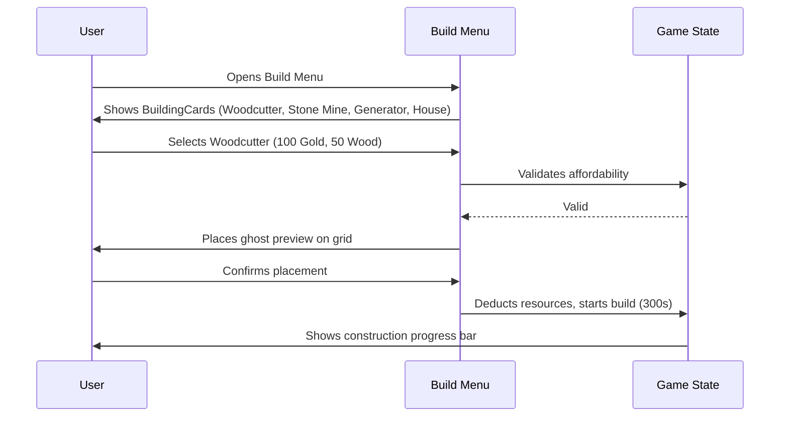
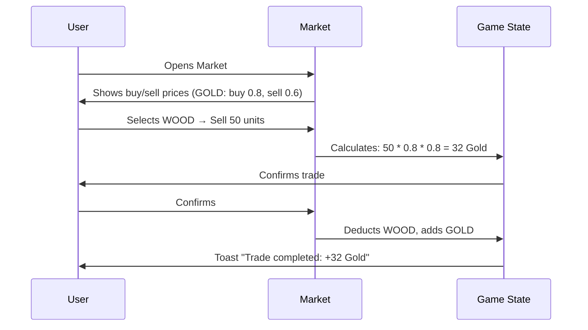

# User Flows: Core Loop

## 1. FTUE (First Time User Experience)
- **Start**: Welcome screen → "Aceptar". Starter resources: Gold 500, Wood 200, Stone 150, Food 100, Energy 50.
- **Step 1**: HUD Reveal (Pointer to Resource Bar) → "Tu ciudad necesita recursos".
- **Step 2**: Open Build Menu (Pointer to Button) → "Construye tu primer aserradero (Woodcutter: 100 Gold + 50 Wood)".
- **Step 3**: Interaction → Drag building to empty tile (Grid 128x128).
- **Step 4**: Construction Logic → "Construyendo (5 min)" → Animation "Pop" → Idle.
- **Step 5**: Harvest → Pointer to "Collect" on Aserradero → Resource Bar +Gold (0.5/tick).
- **Finish**: Congratulations + Goal Tracking (Next: Build Stone Mine).

## 2. Core Loops
- **30s Loop (Harvesting)**: Resource Bar update → Pulse effect on icons. Manual collect cooldown 60s→300s with upgrades.
- **5m Loop (Management)**: Open Building → "Upgrade (Cost: 50 Wood)" → Check affordability → Apply. Queue max 3 buildings.
- **30m Loop (Economy)**: Open Market → Compare resources → Drag slider to set trade amount → Confirm → Success toast. Spread 20%.

## Mermaid Flows

## 3. Build/Upgrade Flow Detail

## 4. Economy/Trade Flow Detail

